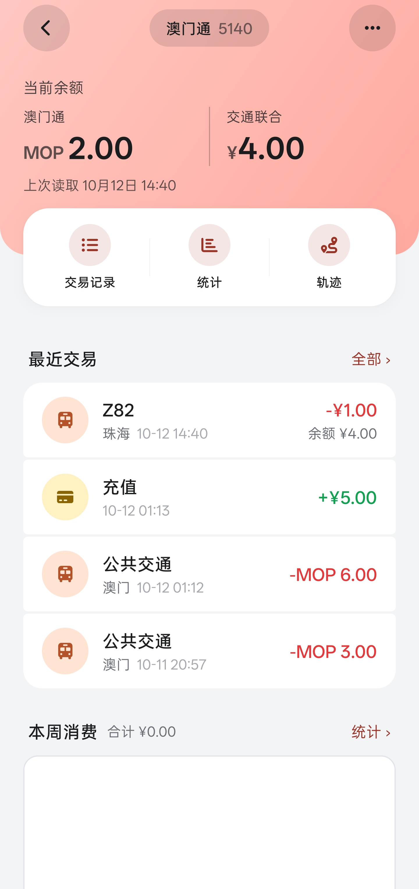
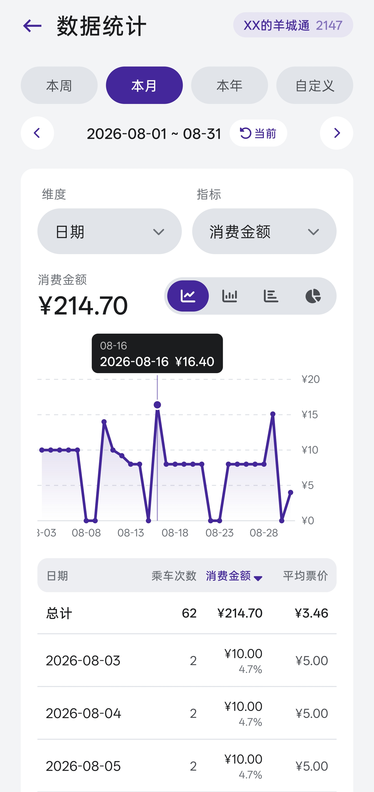
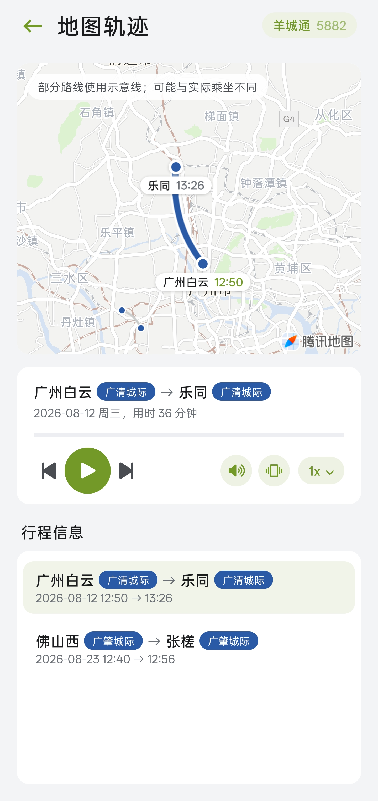

  <h1>TransitU · 行旅录</h1>
  
<strong>Read your transit card. Keep every trip.</strong>

  
Turn what's stored on your card into a trip history you can look back on.

  
<a href="README.md">简体中文</a> | <b>English</b>

  
<a href="https://github.com/HaoTian22/TU-Reader/releases"><b>⬇️ Download latest APK</b></a> · <a href="TECHNICAL.md">Technical docs</a> · <a href="https://github.com/HaoTian22/TU-Reader/issues">Report an issue</a>

  
  
  
  

TransitU (行旅录) is an Android app for reading transit cards and keeping trip records. Hold your phone against a card to read its balance, transaction history and city/line information, then explore local statistics and a trip map.

It is built on public transit-card protocol documentation (the NFC Wiki smart-card handbook), and its station and line data comes from [tripreader-data](https://github.com/HaoTian22/tripreader-data). The app is read-only: it never writes to a card or changes a balance.

## Contents

[Features](#features) · [Supported cards](#supported-cards) · [Screenshots](#screenshots) · [Getting started](#getting-started) · [Data sources & credits](#data-sources--credits) · [Privacy](#privacy--data) · [FAQ](#faq) · [Feedback](#feedback) · [Contributing](#contributing) · [Disclaimer & license](#disclaimer--license)

## Features

| Module | What it does |
|---|---|
| Read | Card number, issue date, expiry, issuer, live balance, issuing city |
| Record | Recent transactions (time, amount, station, card type), rides this month, total discounts |
| Analyze | Spending trends by week / month / year / custom range; total spend, ride count, daily average; most-visited stations and lines |
| Review | Map trails, route playback (play/pause/speed), Tencent Maps transfer plans (start/end only or full journey) |
| Data | Export CSV / JSON / SQLite / read logs; update station and line data online without reinstalling |

## Supported cards

| Card | Notes | Status |
|---|---|---|
| T-Union (交通联合卡) | Nationwide interoperable card, 300+ cities | ✅ Supported |
| Shenzhen Tong (SZT) | Shenzhen public transit card | ✅ Supported |
| Lingnan Pass / Yang Cheng Tong (LNT/YCT) | Guangdong interoperable card | ⚠️ Partial: only some Guangzhou/Foshan metro lines; buses are misidentified |
| Octopus | Hong Kong | ⚠️ Balance only |
| Macau Pass | Macau public transit card | ✅ Supported |
| Suzhou Tong (SUZ) | Suzhou transit card | ❓ Unverified |
| Tianfu Tong (TFT) | Chengdu transit card | ❓ Unverified |
| MOHURD CU (City Union) | City one-card system | ❓ Unverified |

Card not listed, or results look wrong? Open an issue and attach a read log.

## Screenshots

<table>
  <tr>
    <td align="center" width="50%"> Card list</td>
    <td align="center" width="50%"> Transaction list</td>
  </tr>
  <tr>
    <td align="center" width="50%"> Card page</td>
    <td align="center" width="50%"> Card info</td>
  </tr>
  <tr>
    <td align="center" width="50%"> Analytics</td>
    <td align="center" width="50%"> Transaction detail</td>
  </tr>
  <tr>
    <td align="center" width="50%"> Custom charts</td>
    <td align="center" width="50%"> Map trails</td>
  </tr>
</table>

## Getting started

**Requirements:** Android 10+ (API 29+), a device with NFC, and NFC turned on.

1. Download the latest APK from [Releases](https://github.com/HaoTian22/TU-Reader/releases) and install it.
2. Open the app and grant the NFC permission.
3. Hold the card against the NFC area on the back of the phone and keep it still until reading finishes.
4. The card type is detected automatically; browse balance, transactions and statistics.

## Data sources & credits

### Data source

Station, line and city-mapping data comes from [HaoTian22/tripreader-data](https://github.com/HaoTian22/tripreader-data) (public data of the "读卡识途" project). The in-app station update pulls from it.

### Credits

- **[domosekai/tripreader-data](https://github.com/domosekai/tripreader-data)**: the original version of this dataset, collected and published by the "读卡识途" (TripReader) project author and contributors. The repository was archived in March 2025.
- **The "读卡识途" (TripReader) project**: an inspiration for this project's card parsing and station-data curation. Thanks to the original author and all contributors.
- **NFC Wiki smart-card handbook**: public transit-card protocol references.

The original data is licensed under [CC BY 4.0](https://creativecommons.org/licenses/by/4.0/), so attribution must be kept when you use or redistribute it. The data is community-collected and its accuracy is not guaranteed.

## Privacy & data

- **Local first:** cards and transactions are stored on your device and can be cleared or exported separately.
- **Network use:** only when you update station/line data, use Tencent Maps station search and route planning, or enable "public correction upload" to submit your station/line corrections.
- **What is uploaded:** <!-- TODO: list the exact fields and whether card number or timestamps are included -->
- **Read-only:** the app never writes to a card or changes its balance.

## FAQ

**The card won't read.** Move the card around the phone's NFC antenna (usually the upper back), remove metal cases or cases with metal plates, and make sure NFC is on.

**My phone has no NFC.** The app relies on NFC and cannot be used.

**Results differ from the official record.** See the disclaimer below, and please file an issue with a read log.

**Do I need internet?** Not for reading or local statistics. Station updates and route planning do.

## Feedback

- **Bugs / feature requests:** [GitHub Issues](https://github.com/HaoTian22/TU-Reader/issues), or in-app via *Settings → Feedback*.
- **Questions / ideas:** [GitHub Discussions](https://github.com/HaoTian22/TU-Reader/discussions). Or contact me via <a href="mailto:s1qs445l0@mozmail.com">email</a>.
- **Station / line corrections:** tap "Feedback" on a transaction detail page and enter the correct city, line and station. It takes effect on your device immediately; enable "public correction upload" to help improve the shared dataset.

When reporting a problem, please include the app version, phone model, Android version, card type and city, reproduction steps, and screenshots or read logs.

## Contributing

Pull requests are welcome. Please note:

- **Architecture principle:** every feature is built on the card's raw records and the station database. Avoid extra matching rules unless necessary and keep logic generic; any special-case rule must carry the `SP Rule` label (<!-- TODO: define SP Rule or link to TECHNICAL.md -->). Do not persist data that may have been parsed incorrectly; put it in the cache directory instead.
- **Tested:** make sure features work with no obvious bugs. Comment `/build-apk` on a PR to trigger a CI test build.
- **State the scope:** say which card types / cities / modules your change affects, to ease review.
- Send station-data corrections to [tripreader-data](https://github.com/HaoTian22/tripreader-data) first.
- Implementation details, build setup, reading flow, database schema, online update mechanism and APDU references: see [TECHNICAL.md](TECHNICAL.md).

## Disclaimer & license

- This is an unofficial tool, unaffiliated with any card issuer or transit operator. Results are parsed from public protocol documents and may differ from official records; do not rely on them as the sole evidence in a fare dispute.
- About 99% of this project was built with AI assistance (vibe coding). The AI may not fully understand every line it wrote; if you spot a questionable implementation, please point it out and fix it.
- Code is released under the [MIT License](LICENSE); station and line data follows the license of its data repository (CC BY 4.0).
